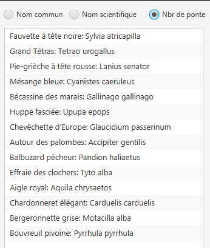
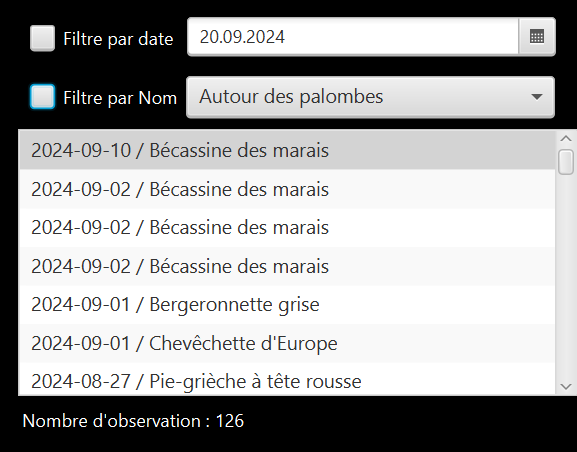
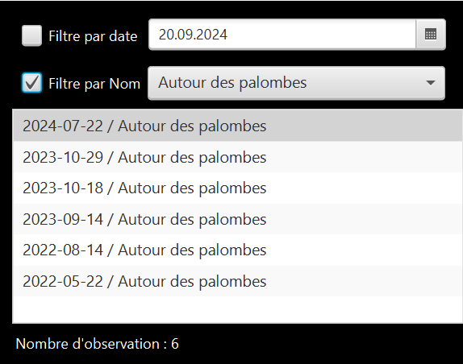
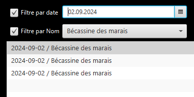
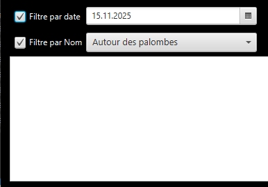

# Challenge DEBUG

## Objectifs

 Par groupe de 2, vous devez debugger l'application Ornithologie le plus rapidement possible en la rendant parfaitement fonctionnelle.

## Fonctionnalités de l'application

Listes des fonctions spécifiques offertes à l'utilisateur:

  Partie centrale :
  - Visualisation d'une liste d'espèce
  - Affichage des détails de l'espèce (image, répartition, description, caractéristiques, ...) lorsque l'espèce est sélectionnée dans la liste
  - Tri par nom scientifique de la liste à l'ouverture de l'application
  - Tri possible par nom commun ou nombre de ponte/durée de séjour au nid

Partie du bas à gauche :
- Visualisation d'une liste des observations effectuées
- Affichage du détail de l'observation lorsqu'elle est sélectionnée dans liste
- Fonction de filtrage des observations: 
  - aucun filtrage
  - par date (la date est sélectionnée dans un calendrier)
  - par nom commun (la liste du nom commun des espèces est proposée)
  - par date et nom commun
- Affichage du nombre d'observations selon le filtre effectué.
- Activation automatique du filtre par nom lors de la sélection d'une espèce dans la partie du haut.
  
Partie du bas à droite :
- Enregistrement d'une nouvelle observation
  - sélection de l'espèce dans une liste
  - sélection de la date dans un calendrier
  - entrée libre du lieu (contrôle que ce champ soit rempli)
  - entrée libre de l'auteur (contrôle que ce champ soit rempli)
- Possibilité d'enregistrer plusieurs observations identiques

## Résultats à obtenir: Tests fonctionnels

Voici ce que vous devez obtenir:

### Pour la partie du haut espèces

- Lors d'un tri par ponte et durée de séjour au nid

- Pour les autre tris, vous effectuez un contrôle vous-même.

## Pour la partie du bas observations

- Lorsque aucun filtre n'est sélectionné 

- Lorsque que le filtre par Nom est sélectionné sur Autour des palombes

- Lors d'un filtre au 2 septembre 2024 pour la Bécassine des marais 

- Lors d'un filtre au 15 novembre 2025 pour l'Autour des palombes

- Lorsque vous ajoutez une observation, elle doit apparaître en premier dans la liste ci-dessus.

 